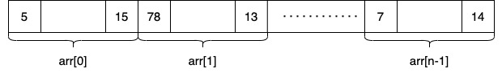

# Седмица 5 - Масиви - 05.11.2026г.

## Едномерни масиви

### Декларация

```
<тип> <име>[<размер>] [= {<стойност-елемент-0>, <стойност-елемент-0>, ...}];
```

**!!<размер> трябва да бъде константна стойност или литерал(цифра)!!**

Името на масива може да се разглежда като константен указател към първия му елемент.

### Дефиниция

Примери:

```c++
int arr1[5]; // заделени са 5 int обекта; ако масивът е локален (във функция), стойностите са произволни, а ако е глобален - всички са 0

char arr2[2] = {'a', 'b'}; // заделени са 2 char обекта със стойности съответно 'a' и 'b'

double arr3[] = {5.5, 6.0023}; // размерът на масива се определя по броя дадени стойности, т.е. заделени са два double обекта със съответните стойности

int arr4[5] = {1, 2}; // първият и вторият елемент имат стойности съответно 1 и 2, всички останали получават стойността по подразбиране за типа, в случая - 0.

int arr5[6] = {0} // масивът се инициализира с 0-ли
<=> int arr6[6] = {};
```

### Достъп до елемент

При масив `int arr[1028]` всеки от 1028-те елемента в масива може да бъде достъпен чрез индекс. Индексите се броят от 0 до <размер> - 1, т.е. в случая от 0 до 1027.

Пример:

```c++
int arr[1028] = {1,2,3,4,5,6,7,8,9,10,11};

std::cout << arr[0] << "," << arr[10]; // извежда 1,11

std::cout << arr[35] << "," << arr[1027]; //извежда две нули (стойността по подразбиране на int)

std::cout << arr[1028]; // хвърля грешка - segmentation error (в повечето случаи)
```

### Операции над масиви

```c++
int arr[1028];
```

Името на масива не е указател, но при използване почти винаги се преобразува до указател към първия му елемент, т.е. `arr == &arr[0]`. Изключение е `sizeof(arr)`, което връща размера на целия масив в байтове (тук `1028 * sizeof(int)`), а не размера на указател.

Пример:

```c++
const int N = 1028;
int arr[N];

std::cout << arr; //извежда адреса на елемента с индекс 0
std::cout << arr + 2; // извежда адреса на елемента с индекс 2

int* p_arr = arr;

for(int i = 0; i < N; i++) {
    std::cout << *p_arr++; // заради оператор `*` извеждаме стойността на текущо сочения елемент от масива, а от оператор `++` караме p_arr да сочи към следващия елемент
}

std::cin >> arr; // грешка, не можем да въвеждаме указатели
std::cin >> p_arr; // също грешка, по същата причина

int arr2[N];
std::cout << (arr == arr2); // сравнява адресите, а не елементите, затова винаги извежда 0 (false); без скобите не се компилира

```

## Двоично търсене

- **Редицата е наредена.**
- Разглежда се средният елемент.
- Ако той е търсеният, сканирането се преустановява.
- В противен случай търсенето продължава в лявата или дясната
  половина на редицата в зависимост от това дали х е по-малък или по-голям от средния елемент.
- Действията се повтарят за съответната подредица.

## Двумерни масиви

Това са едномерни масиви, чиито елементи са също едномерни масиви с еднаква дължина.

```
<тип> <име>[<брой едномерни масиви>][<размер на едномерните масиви>];
```

При употреба най-често третираме двумерните масиви като таблици, в които има толкова редове, колкото едномерни масива имаме, и толкова колони, колкото е размерът на тези едномерни масиви. Следователно горният запис е еквивалентен на:

```
<тип> <име>[<брой редове>][<брой колони>];
```

### Представяне в паметта

Двумерният масив - `int arr[3][4]` заема 12 последователни `int`-а в паметта, подредени ред по ред.  
`arr[i]` е i-тият ред (масив от 4 `int`), който при употреба се преобразува до указател към `arr[i][0]`.  
Затова `arr[i][j]` е елементът, намиращ се на `i * 4 + j` позиции от началото на масива.  


### Синтаксис

```c++
int arr1[3][4]; // създава се матрица с 3 реда и 4 колони

int arr2[3][4] = { { 1, 2, 3, 4 }, { 9, 8, 7, 6 }, { 11, 12, 13, 14 } }; // изреждаме редовете

int arr3[3][4] = { 1, 2, 3, 4, 9, 8, 7, 6, 11, 12, 13, 14 }; // еквивалентно на горния вариант

int arr4[][4] = { 1, 2, 3, 4, 9, 8, 7, 6, 11, 12, 13, 14 }; // можем да изпуснем най-левия размер - броят на редовете се изчислява автоматично (12 / 4 = 3)
```

### Достъп до елемент

Индексите на редовете са от 0 до <брой редове> - 1, а на колоните - от 0 до <брой колони> - 1.

```c++
int arr[3][4] = { { 1, 2, 3, 4 }, { 9, 8, 7, 6 }, { 11, 12, 13, 14 } };

std::cout << arr[1][2]; // извежда 7 - елементът на ред 1, колона 2
arr[0][0] = 5; // променя първия елемент на първия ред
```

### Въвеждане и извеждане

Външният цикъл обхожда редовете, а вътрешният - колоните на текущия ред.

```c++
const int SIZE = 100;
int arr[SIZE][SIZE];
int n, m;
std::cin >> n >> m; // брой редове и брой колони, n, m < SIZE

for (int i = 0; i < n; i++) {
    for (int j = 0; j < m; j++) {
        std::cin >> arr[i][j];
    }
}

for (int i = 0; i < n; i++) {
    for (int j = 0; j < m; j++) {
        std::cout << arr[i][j] << " ";
    }
    std::cout << std::endl;
}
```

### Подаване на функция

```c++
const int M = 4;

void func(int arr[][M], int n, int m) { // m <= M
    for(int i = 0; i < n; i++) {
        for(int j = 0; j < m; j++) {
            //правим нещо с arr[i][j];
        }
    }
}
```

Както при дефиницията, можем да изпуснем най-левия размер, но всички останали трябва да бъдат зададени като константи. Причината е, че за да намери `arr[i][j]`, компилаторът изчислява позицията `i * M + j` и затова трябва да знае броя на колоните `M`.  
Броят на редовете `n` и броят на реално използваните колони `m` (`m <= M`) се подават като отделни параметри - така функцията работи и когато матрицата е запълнена само частично.

Както при едномерните масиви, параметърът `arr` всъщност е указател - от тип `int (*)[M]` (указател към ред от `M` елемента). Затова `sizeof(arr)` във функцията връща размера на указател, а не на цялата матрица.

## Многомерни масиви

Аналогично можем да дефинираме масиви с повече измерения. Например тримерният масив е масив от двумерни масиви:

```c++
int cube[2][3][4]; // 2 матрици с по 3 реда и 4 колони - общо 24 int елемента, отново последователно в паметта

cube[1][2][3] = 5; // елементът от матрица 1, ред 2, колона 3
```

При подаване на функция отново може да се изпусне само най-левият размер: `void func(int cube[][3][4], int n)`.

## Задачи

#### _За всички задачи приемаме, че въведеният размер на масива е по-малък от константа SIZE, която ще си дефинираме в началото на програмата. При двумерните масиви това важи и за двата размера - броя на редовете `n` и броя на колоните `m`._

### Задача 1

Напишете програма, която обръща реда на стойностите в подаден масив.

### Задача 2

Напишете програма, която приема масив и проверява дали е палиндром.  
След това променете _малко_ решението, така че програмата да проверява дали дадено число е палиндром.

### Задача 3

Напишете програма, която намира всички отрицателни числа в целочислен масив и ги премества в края му, без да променя реда на положителните.
Масивът се въвежда, като от конзолата се прочита числото n - размерът на масива, последвано от n на брой числа - елементите на масива.  
Пример:  
Вход:  
7  
-5  
6  
89  
32  
-9  
-1  
28  
Примерен изход (редът на отрицателните числа може да е различен):  
6, 89, 32, 28, -5, -9, -1

### Задача 4

Напишете програма, която намира най-дългата поредица от еднакви числа в даден масив. Нека програмата да изведе самото число и колко е дълга поредицата му. Ако има две поредици с еднакви числа и еднаква максимална дължина, изведете информацията за първата.
Пример:  
12  
2 9 9 9 9 6 5 4 6 6 6 3 -> 9 4  
5  
1 2 0 3 6 -> 1 1  
6  
3 3 9 5 5 6 -> 3 2

### Задача 5

Напишете функция `void sortArray(int arr[], unsigned int size)`, която приема целочислен масив и размера му и го сортира във възходящ ред. Използвайте я в програма, която въвежда масив и извежда сортирания масив.

Пример:  
arr = {1, 5, 7, 3, 4, 2, 8}  
Изход: 1, 2, 3, 4, 5, 7, 8

### Задача 6

Напишете функция `int binarySearch(const int arr[], unsigned int size, int c)`, която приема сортиран целочислен масив, размера му и число `c`. Използвайки двоично търсене, функцията да връща индекса, на който се намира стойността `c`, или `-1`, ако я няма в масива. Използвайте я заедно с функцията от задача 5: програмата въвежда масив и число `c`, сортира масива и извежда резултата от търсенето.

Пример:  
arr = {1, 2, 3, 4, 5, 7, 8}  
c = 5  
Изход: 4  
c = 10  
Изход: -1

### Задача 7

Напишете програма, която намира трите най-големи числа в масив с целочислени елементи. Масивът се въвежда, като от конзолата се прочита числото `n` - размерът на масива, последвано от `n` на брой числа - елементите на масива.

Пример:  
Вход:  
5  
12 3 73 43 98  
Изход:  
98, 73, 43

### Задача 8

Напишете програма, която намира най-малката и най-голямата сума на `m` елемента в даден масив. Масивът се въвежда, като от конзолата се прочита числото `n` - размерът на масива, числото `m` - броят на елементите, които ще събираме, последвано от `n` на брой числа - елементите на масива.

Пример:  
Вход:  
5 4  
1 2 3 4 5  
Изход:  
10 14

(10 = 1 + 2 + 3 + 4 - най-малката сума на 4 елемента от масива)  
(14 = 2 + 3 + 4 + 5 - най-голямата сума на 4 елемента от масива)

### Задача 9

Напишете програма, която приема масив от малки латински букви и изписва на конзолата "кодирана" негова версия. Вместо дадената буква да се изпише на конзолата колко пъти се среща в масива.

Пример:  
Вход:  
5  
a b c a a  
Изход:  
3 1 1 3 3

### Задача 10

Определете кои от трите характеристики притежава дадена редица.  
Свойство 1: Няма две съседни числа с еднаква четност  
Свойство 2: Всяко число с четен индекс е равно на сбора на съседните две. Пропускаме числото, ако няма един съсед.  
Свойство 3: Сред цифрите на всяко число присъства индексът, на който се намира.

Вход: От стандартния вход се въвежда: n - размерът на масива, последван от n числа, съответно елементите на редицата.

Изход: На стандартния изход изведете номерата на свойствата, които редицата изпълнява.

### Задача 11

Напишете програма, която въвежда двумерен масив (матрица) с целочислени елементи и извежда сумата на всички негови елементи.
Матрицата се въвежда, като от конзолата се прочитат числата `n` и `m` - броят на редовете и колоните, последвани от `n * m` числа - елементите на матрицата, ред по ред.

Реализирайте функцията `int sumMatrix(const int matrix[][SIZE], unsigned int rows, unsigned int cols)`.

**Допълнение:** Напишете функциите `int minElement(const int matrix[][SIZE], unsigned int rows, unsigned int cols)` и `int maxElement(const int matrix[][SIZE], unsigned int rows, unsigned int cols)`, които връщат съответно най-малкия и най-големия елемент на матрицата, и изведете и тях.

Пример:  
Вход:  
3 4  
1 -2 3 4  
5 6 -7 8  
9 10 11 -12  
Изход:  
Сума: 36  
Мин: -12  
Макс: 11
