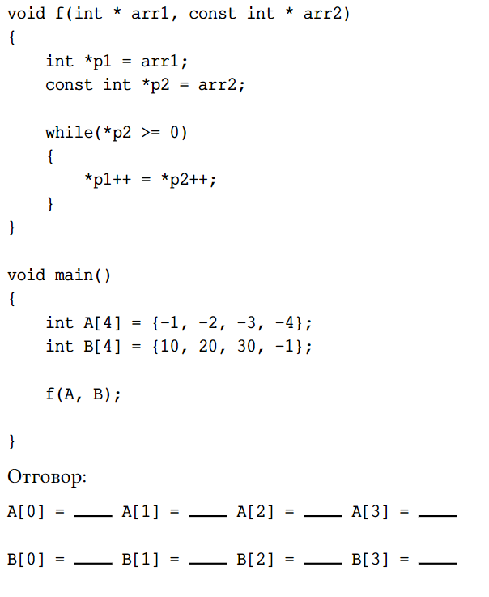

# Седмица  - Динамична памет и обработка на грешки - 19.11.2026 г.

## Динамична памет
**stack**
- паметта се заделя ПРЕДИ да се компилира програмата.
- паметта се освобождава/трие/маркира като свободна автоматично - при излизането от scope-а,  в който е дефинирана.

Искаме памет по време на изпълнението на програмта?
**heap** 
 - Масиви и обекти без предварително да е известна големината.


Оператор **new**

- Връща указател към началото на паметта

```c++
new int[n];  n НЕ е задължително да е константа!
```

Динамичната памет НЕ се трие автоматично.

Оператор delete[] - освобождава/маркира като свободна динамична памет!    
**НЕ трябва да се извиква повече от веднъж!**


```c++
void f()
{
  int x = 40;
  char ch[2] = {'a', 'b'};
  int* ptr = new int[3];
}
```

След приключването на функцията ще се изчисти паметта в стека, но НЕ и паметта в heap-а.

Ние трябва ръчно да я маркираме като свободна.

```c++
void f()
{
  int x = 40;
  char ch[2] = {'a', 'b'};
  int* ptr = new int[3];
  delete[] ptr; //!!!!!!!
}
```

## Assert, throw, try, catch
### Assert
```
assert(<условие>);
```
-> Прекратява изпълнението на програмата ако условието не е изпълнено.

### throw
```
throw <exception>;
```
```
throw std::exception();
throw std::runtime_error("Dividing by 0");
```
-> `<exeption>` e променлива от тип std::exception или негов подклас. Всички класове от exceptions може да намерите [тук](https://en.cppreference.com/w/cpp/error/exception).

### try-catch
```
try {
    <код, който може да хвърли грешка>
} catch (<exception>) {
    <код, който се изпълнява след като сме получили грешка от тип <exception> >
} [ catch (<exception>) {
    ...
}
.
.
.
]
```

```
void func() {
    throw std::exception("Some issue");
}

int main () {
    try {
        func();
    } catch (const std::exception& e) {
        cout << "Error while executing func :"
            << e.what() << endl;
    }
}

```


## Задачи

### 0. задача - throw, try и catch

Изписва число, което е подадено чрез указател и хвърля грешка, ако е подаден `nullptr`.

### 1. задача

В дадените по-долу празни места попълнете какви ще бъдат стойностите на елементите на двата масива A и B след обръщението към функцията f.


### 2. задача

Въведете матрица от конзолата - първо се въвеждат размерите и после се въвеждат самите елементи.
По въведена матрица, запишете минималния елемент от всеки ред в отделен масив.


### 3. задача

Триъгълна матрица се нарича такава квадратна матрица, която има само нулеви елементи под или над главния или вторичния си диагонал. Да се напише функция, която проверява дали подаден двумерен масив, с размерност size x size, е триъгълна матрица.

### 4. задача

Напишете програма, която прочита от стандартния вход размера на масив Да се напише функция, която приема като аргумент число "k" и масив с размер n и да изтрива от него k-тия елемент.


### 5. задача

Да се напише функция, която приема като аргумент число "k" и матрица nxm и да изтрива от нея k-тия ред.

### 6. задача

Да се напише функция, която приема като аргумент число "k" и матрица nxm и да се изтрива от нея k-тия стълб.
